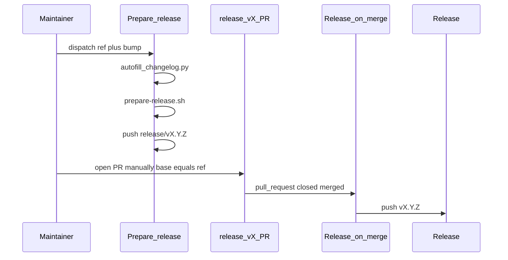
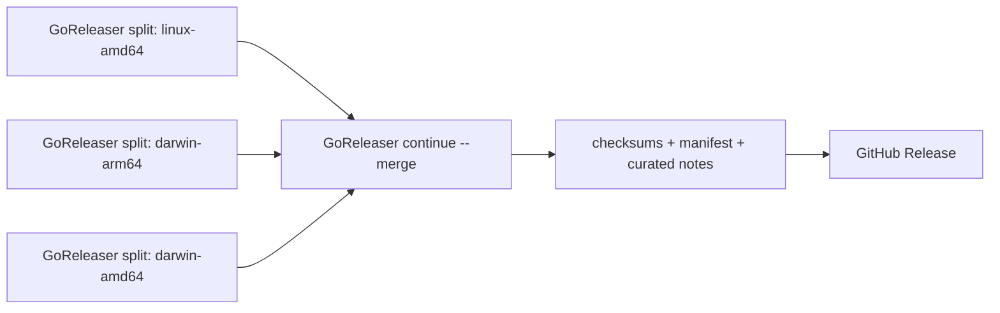

# 003 — CLI release process (design)

## Workflows

| Workflow | Trigger | Outcome |
|----------|---------|---------|
| **Prepare release** | `workflow_dispatch` | Autofill → bump VERSION → finalize CHANGELOG → push `release/vX.Y.Z` |
| **Release on merge** | `release/v*` PR merged to `main` or `release/**` | Push `vX.Y.Z` tag |
| **Release** | Push tag `v*`, or `workflow_dispatch` with an existing exact SemVer tag | GoReleaser Pro split builds, checksums, manifest, and GitHub Release (title = tag; body = `CHANGELOG.md` `[VERSION]` section via `extract-changelog-section.py`) |
| **Create release tag** | `workflow_dispatch` | Manual/dry-run tag (escape hatch) |

## Scripts

| Script | Role |
|--------|------|
| [`scripts/autofill-changelog.py`](../../../scripts/autofill-changelog.py) | Fill missing `[Unreleased]` bullets from merged PRs / git since last tag |
| [`scripts/prepare-release.sh`](../../../scripts/prepare-release.sh) | Semver bump + finalize CHANGELOG section |
| [`scripts/validate-release-tag.sh`](../../../scripts/validate-release-tag.sh) | Shared tag validation for create-release and release-on-merge |
| [`scripts/check-coverage.sh`](../../../scripts/check-coverage.sh) | Enforce `COVER_MIN` against `coverage.out` from `make test-cover` |

## CI test job

The `test` workflow job runs `make build-go test-cover-check vet`. On pull requests it also runs `make test-diff-cover-check` against the merge base. Package scope and exclusions for the coverage gate are defined in `Makefile` (`GO_COVER_PKGS`, `COVER_MIN`, `DIFF_COVER_MIN`); see **REQ-08** and **REQ-09** in `requirements.md`.

## Autofill sources

1. `gh pr list --state merged --base {ref}` when `gh` and `GITHUB_TOKEN` are available.
2. Fallback: `git log {since_tag}..HEAD --merges --first-parent` parsing `#NNN` from merge subjects.

## Branch naming

| Pattern | Meaning |
|---------|---------|
| `release/v0.1.1` | Ephemeral prepare branch (VERSION/CHANGELOG bump); PR opened manually |
| `release/0.1.x` | Long-lived stabilization / patch line (merge base for prepare PRs) |

## Permissions

- **Prepare release:** `contents: write`
- **Release on merge:** `contents: write`
- **Release build/test jobs:** `contents: read`
- **Release publish job:** `contents: write`
- Concurrency group `release-tag` prevents double tag push

## GoReleaser integration

The Release workflow uses a **GoReleaser Pro split/merge** design:

1. A target matrix runs `goreleaser release --split` on Linux amd64, macOS
   amd64, and macOS arm64 runners. Each runner stages and verifies its
   embedded-Python bundle before the secret-bearing GoReleaser step. GoReleaser
   compiles the tagged source with `embed_python`; a following secret-free step
   smoke-tests the resulting native binary and embedded analyzer.
2. Each split job uploads its complete GoReleaser partial directory as a workflow
   artifact. The merge job downloads those immutable partials; it does not rebuild.
3. `goreleaser continue --merge` generates `checksums.txt`, renders
   `manifest.json`, and publishes the three binaries and metadata to GitHub
   Releases using the curated `CHANGELOG.md` version section.

`partial.by: target` keeps the two macOS architectures independent. This is
required because each binary embeds a CPython distribution that must execute on
the target runner while `cisco-aibom` is installed. The workflow requires a
repository Actions secret named `GORELEASER_KEY`; no license value is stored in
the repository.

| Target | Runner | GoReleaser filter | Partial artifact |
|--------|--------|-------------------|------------------|
| `linux_amd64` | `ubuntu-latest` | `GGOOS=linux`, `GGOARCH=amd64` | `goreleaser-partial-<tag>-<commit>-linux-amd64` |
| `darwin_amd64` | `macos-15-intel` | `GGOOS=darwin`, `GGOARCH=amd64` | `goreleaser-partial-<tag>-<commit>-darwin-amd64` |
| `darwin_arm64` | `macos-15` | `GGOOS=darwin`, `GGOARCH=arm64` | `goreleaser-partial-<tag>-<commit>-darwin-arm64` |

Every split and merge checkout uses `fetch-depth: 0`. Before compilation, the
workflow verifies that the staged CPython executable matches the selected target.
The bundle preparation and all repository/dependency code execute before
`GORELEASER_KEY` is exposed. After compilation, a separate step without the key
runs `make smoke-test-bin` plus `ai-bom analyze --help`; the latter extracts and
executes the embedded interpreter.

The exact release inventory is three raw, unarchived binaries plus
`checksums.txt` and `manifest.json`; source archives and GoReleaser metadata
assets are disabled. A post-publication parity check downloads the metadata and
verifies the final basenames, the three SHA-256 checksum entries, and the existing
manifest schema. A mismatch fails the release run for operator remediation.

Manual recovery dispatches validate the input before checkout, accept only an
exact `v<semver>` tag, and check out `refs/tags/<tag>` with persisted Git
credentials disabled. A same-run **Re-run failed jobs** operation reuses the
successful immutable partial artifacts. A new `workflow_dispatch` deliberately
rebuilds all three partials from the immutable tag; partials are named with tag,
commit, and target and are never mixed across workflow runs. Split jobs have
`contents: read`; only the merge/publish job receives `contents: write`.

The GoReleaser Pro binary can run `goreleaser check` without a license. Pull
requests, including forks, therefore validate the pinned Pro configuration
without receiving secrets. Tagged release runs have an initial trusted job that
installs the same Pro version, validates the configuration, and runs
`goreleaser license-verify` before any platform build starts.

