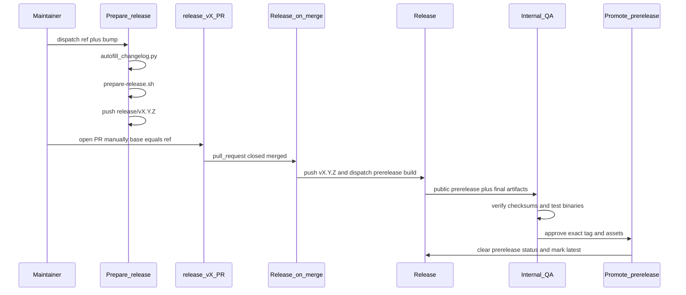

# 003 — CLI release process (design)

## Workflows

| Workflow | Trigger | Outcome |
|----------|---------|---------|
| **Prepare release** | `workflow_dispatch` | Autofill → bump VERSION → finalize CHANGELOG → push `release/vX.Y.Z` |
| **Release on merge** | `release/v*` PR merged to `main` or `release/**` | Push `vX.Y.Z` tag and dispatch a prerelease |
| **Release** | Push tag `v*` or `workflow_dispatch` | Embed builds, checksums, manifest, and a public GitHub prerelease by default (title = tag; body = `CHANGELOG.md` `[VERSION]` section via `extract-changelog-section.py`) |
| **Promote prerelease** | `workflow_dispatch` | Validate a stable-version prerelease and promote the same tested assets to the latest stable release |
| **Create release tag** | `workflow_dispatch` | Manual/dry-run tag (escape hatch); prerelease by default, with an explicit stable-release override |

## Prerelease-first release and internal QA

The normal release path stages the final `vX.Y.Z` tag as a public GitHub prerelease.
The prerelease, notes, assets, tag, and GitHub Actions logs are visible to everyone,
including Enterprise Managed User (EMU) accounts that do not have repository write
access. They MUST NOT contain confidential release data or credentials.

Internal QA downloads the prerelease assets, verifies
`checksums.txt`, and records the tested tag, commit, platform, and binary digest. The
assets are frozen during QA. Any asset replacement invalidates QA approval and
requires another test pass.

Promotion updates the existing prerelease; it does not rebuild or upload assets. A
read-only job validates the candidate before the `production-release` GitHub
environment requests human approval. The publishing job revalidates the prerelease
after approval, immediately before clearing prerelease status and marking the release
latest, and is the only job granted write access.
Repository administrators MUST configure required reviewers on the environment.
Promotion accepts only stable `vX.Y.Z` tags, rejects drafts and already-stable
releases, and verifies that
the expected binaries, checksum file, and manifest are present before publication.

## Scripts

| Script | Role |
|--------|------|
| [`scripts/autofill-changelog.py`](../../../scripts/autofill-changelog.py) | Fill missing `[Unreleased]` bullets from merged PRs / git since last tag |
| [`scripts/prepare-release.sh`](../../../scripts/prepare-release.sh) | Semver bump + finalize CHANGELOG section |
| [`scripts/validate-release-tag.sh`](../../../scripts/validate-release-tag.sh) | Shared tag validation for create-release and release-on-merge |
| [`scripts/check-coverage.sh`](../../../scripts/check-coverage.sh) | Enforce `COVER_MIN` against `coverage.out` from `make test-cover` |

## CI test job

The `test` workflow job runs `make build-go test-cover-check vet`. On pull requests it also runs `make test-diff-cover-check` against the merge base. Package scope and exclusions for the coverage gate are defined in `Makefile` (`GO_COVER_PKGS`, `COVER_MIN`, `DIFF_COVER_MIN`); see **REQ-08** and **REQ-09** in `requirements.md`.

## Autofill sources

1. `gh pr list --state merged --base {ref}` when `gh` and `GITHUB_TOKEN` are available.
2. Fallback: `git log {since_tag}..HEAD --merges --first-parent` parsing `#NNN` from merge subjects.

## Branch naming

| Pattern | Meaning |
|---------|---------|
| `release/v0.1.1` | Ephemeral prepare branch (VERSION/CHANGELOG bump); PR opened manually |
| `release/0.1.x` | Long-lived stabilization / patch line (merge base for prepare PRs) |

## Permissions

- **Prepare release:** `contents: write`
- **Release on merge:** `contents: write`
- **Release:** `contents: write`
- **Promote prerelease:** validation job `contents: read`; publishing job
  `contents: write`, plus required reviewers on the `production-release` environment
- Concurrency group `release-tag` prevents double tag push
