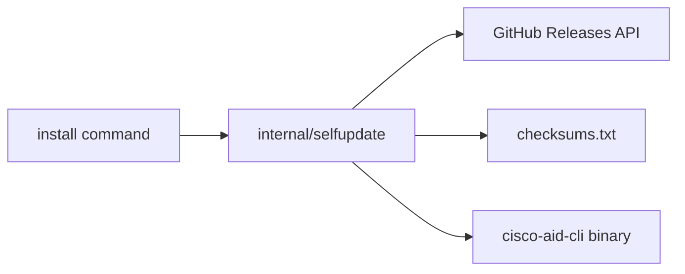

# 005 — CLI install design

## Command tree

```
cisco-aid-cli install [--version VERSION] [--check] [--prefix DIR]
```

## Data flow



## Platform matrix

| GOOS/GOARCH | Artifact suffix |
|-------------|-----------------|
| linux/amd64 | linux-amd64 |
| darwin/arm64 | darwin-arm64 |
| darwin/amd64 | darwin-amd64 |

Unsupported combinations return usage error (exit 2).

## Release resolution

1. `latest` → `GET /repos/cisco-ai-defense/ai-defense-cli/releases/latest`
2. Pinned → `GET /repos/.../releases/tags/vX.Y.Z`
3. Download `checksums.txt` and platform binary from release assets
4. Verify checksum line for artifact filename
5. Write to `<prefix>/cisco-aid-cli` (or `--prefix` + basename)

## In-place replacement

Default `--prefix` is the directory containing the running executable (`selfupdate.DefaultPrefix`). The install step atomically replaces `<prefix>/cisco-aid-cli` with the downloaded release binary.

- **Unix (Linux/macOS):** Replacing the binary while a process is running is supported; the OS keeps the old inode for the running process. The new binary is used on the next launch.
- **Windows:** Executable files may be locked while running; install may fail until other instances exit.
- **Recommendation:** After install, run `cisco-aid-cli --version` in a new shell to confirm the updated build.

## Security

- HTTPS only to `github.com` / `api.github.com`
- Checksum verification mandatory; abort on mismatch
- No credentials in install path
