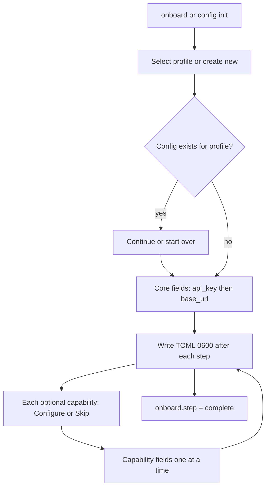
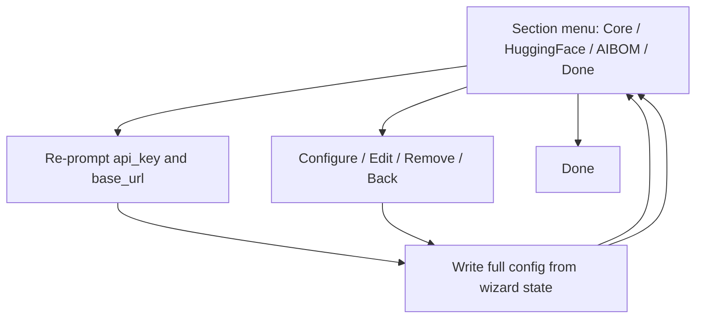

# 006 — CLI config design

## UX flow

### Onboard / config init



- `--profile` skips the profile step. Picker shows stored active profile and lists on-disk profiles (`*` = active).

- No separate confirm screen per step; Enter on the select/input advances.
- Cancel/interrupt leaves the last saved draft on disk.

### config edit



Edit writes the **full** config from wizard state (no merge of removed sections).

### config show

- TTY: menu → Overview | Core | each capability | Print plain TOML | Exit
- Secrets redacted via `spec.SecretTomlPaths()`
- Note in UI: env/flags override file values at runtime

## TOML shape

```toml
[default]
api_key = "..."
base_url = "https://us.api.aidefense.security.cisco.com"

[default.huggingface]  # optional
token = "..."

[default.aibom]  # optional
llm_model = "..."
llm_provider = ""
llm_api_key = "..."
llm_api_base = ""
llm_api_version = ""

[onboard]  # wizard progress (not used at runtime)
step = "complete"
```

## Spec-driven config

The CLI config **schema** is declared in [`config.spec.yaml`](../../../internal/config/spec/config.spec.yaml).
The `default` section's `fields` mirror TOML: scalars (`api_key`, `base_url`) and `kind: group`
entries (`huggingface`, `aibom`) for nested tables. User secrets are written to **`config.toml`**.
The YAML spec is embedded at build time and drives:

- Onboarding wizard (`CollectWizard`, `CollectWizardFunc`)
- Runtime resolution (`Resolve`: flags → env → TOML)
- Secret redaction (`SecretTomlPaths`)
- Capability hub registration (`optional: true` on group fields)

Example **user config** output shape: [`docs/config.sample.toml`](../../../docs/config.sample.toml).

### Adding an optional capability

1. Add a `kind: group` field under `default.fields` in `config.spec.yaml` with `optional: true`
2. For complex validation, register a named validator in `validators.go`
3. Rebuild — wizard, redaction, resolution, and capability hub pick it up via `spec.OptionalSections()` / `spec.ByID(id)`

Commands that consume an integration at runtime look it up by id (e.g. `spec.MustByID("aibom")` in `internal/cli/aibom/`). No changes to `load.go` or per-integration package vars.

Simple validation uses declarative rules:

```yaml
validate:
  - type: non_empty
    field: token
    message: huggingface token is required
```

## Package layout

```
internal/config/spec/       declarative section specs (config.spec.yaml)
internal/config/            paths, profiles, read/write, redact via spec
internal/cli/config/
  wizard.go                 onboard / config init
  edit_tui.go               config edit hub
  show_tui.go               config show browser
  profile.go                config profile subcommands
  profile_wizard.go         onboard profile picker
  progress.go               onboard.step ordering
  capabilities/
    registry.go
    spec_capability.go
internal/cli/onboard/
internal/tui/                 shared huh theme + form helpers (matches --help styling)
internal/cmdutil/doclinks.go  public user-guide URL for clients
```

## Capability interface

```go
type Capability interface {
    ID() string
    Label() string
    Description() string
    IsConfigured(m *config.Manager) bool
    Collect(ctx *WizardContext) error
    Validate(ctx *WizardContext) error
    Apply(ctx *WizardContext, data map[string]any)
    NextSteps() []string
    MissingHint() string
}
```

## Base URL field

`base_url` is a field on the required `default` section with wizard `options` (regional endpoints) and
`allow_custom: true` so users can pick a preset or enter a custom `*.cisco.com` URL.
Only `base_url` is stored in TOML — see `config.spec.yaml` under `default.fields`.

## Config discovery

`ExistingConfigPath()` returns the first on-disk config (home, legacy XDG, or legacy project) for onboarding resume.
`ResolveConfigPath()` returns the path used at runtime (same priority, defaulting to `~/.ai-defense/config.toml`).
`ConfigPathForWrite()` is where the wizard persists settings.

## Profiles

Layout:

```
~/.ai-defense/
  config.toml           # default profile
  profile               # active profile name (e.g. "work")
  profiles/
    work.toml
    staging.toml
```

`ActiveProfile()` resolves from flag override → env → `profile` file → `default`.
`ProfileConfigPath(name)` maps `default` → `config.toml`, else `profiles/<name>.toml`.
