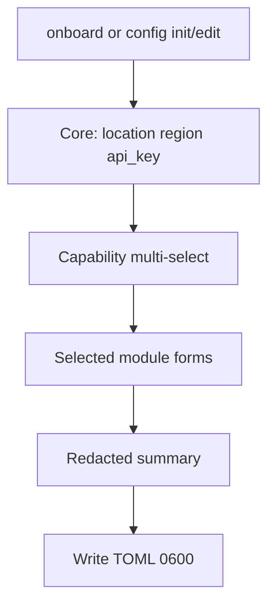

# 006 — CLI config design

## UX flow



## TOML shape

```toml
[default]
api_key = "..."
base_url = "https://us.api.aidefense.security.cisco.com"

[default.huggingface]  # optional
token = "..."

[default.aibom]  # optional
llm_model = "..."
llm_provider = ""
llm_api_key = "..."
llm_api_base = ""
llm_api_version = ""
```

## Spec-driven integrations

The CLI config **schema** is declared in [`config.spec.yaml`](../../../internal/config/spec/config.spec.yaml)
(an OpenAPI-style contract: fields, env vars, flags, wizard presets, validation). User secrets
are still written to **`config.toml`**. The YAML spec is embedded at build time and drives:

- Onboarding wizard (`CollectWizard`)
- Runtime resolution (`Resolve`: flags → env → TOML)
- Secret redaction (`SecretTomlPaths`)
- Capability hub registration

Example **user config** output shape: [`docs/config.sample.toml`](../../../docs/config.sample.toml).

### Adding an integration

1. Add an integration entry to `config.spec.yaml`
2. For complex validation, register a named validator in `validators.go`
3. Rebuild — wizard, redaction, resolution, and capability hub pick it up via `spec.Integrations()` / `spec.ByID(id)`

Commands that consume an integration at runtime look it up by id (e.g. `spec.MustByID("aibom")` in `internal/cli/aibom/`). No changes to `load.go` or per-integration package vars.

Simple validation uses declarative rules:

```yaml
validate:
  - type: non_empty
    field: token
    message: huggingface token is required
```

## Package layout

```
internal/config/spec/       declarative integration specs
internal/config/            paths, read/write, redact via spec
internal/cli/config/
  wizard.go
  capabilities/
    registry.go
    spec_capability.go
internal/cli/onboard/
```

## Capability interface

```go
type Capability interface {
    ID() string
    Label() string
    Description() string
    IsConfigured(m *config.Manager) bool
    Collect(ctx *WizardContext) error
    Validate(ctx *WizardContext) error
    Apply(ctx *WizardContext, data map[string]any)
    NextSteps() []string
    MissingHint() string
}
```

## Region → base URL

| Region | base_url |
|--------|----------|
| US | https://us.api.aidefense.security.cisco.com |
| EU | https://eu.api.aidefense.security.cisco.com |
| AP | https://ap.api.aidefense.security.cisco.com |
| UAE | https://uae.api.aidefense.security.cisco.com |
